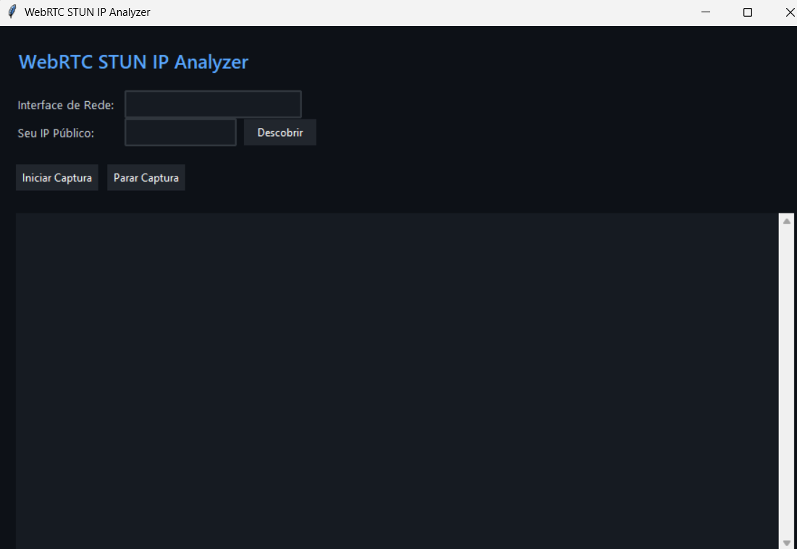

# WebRTC STUN IP Analyzer 🕵️‍♂️🌐

A network traffic analyzer with a Graphical User Interface (GUI) built in Python to demonstrate and monitor the leakage of public IP addresses via WebRTC using the STUN protocol.

This tool acts as a Proof of Concept (PoC) to illustrate how WebRTC can expose a user's true location and IP address during Peer-to-Peer (P2P) connection negotiation, even when certain proxy configurations or improperly configured VPNs are in use.

 

  

## 🚀 Features

* **Real-Time Capture:** Intercepts live UDP network packets focusing on the STUN protocol.
* **Precision Filtering (TShark):** Isolates *Binding Response* (`0x0101`) messages containing the *XOR-MAPPED-ADDRESS* attribute (`0x0020`), which is exactly where the real IP is exposed.
* **Automated Geolocation:** Queries the `ip-api.com` API to map captured IPs, returning City, Country, and Internet Service Provider (ISP). Includes a local caching system to prevent API rate-limiting.
* **Self-IP Exclusion:** Features a built-in tool to fetch your current public IP and exclude it from the capture logic, focusing the analysis solely on remote peers.
* **Graphical Interface (Tkinter):** A clean, dark-themed dashboard for easy configuration, visualization, and log monitoring.

## 🛠️ Prerequisites

To run this project, you must have the following installed on your machine:

1. **Python 3.x**
2. **Wireshark / TShark:** The script uses `tshark.exe` under the hood for packet capturing.
   * *Note:* By default, the script looks for the executable at `C:\Program Files\Wireshark\tshark.exe` (Standard Windows path).

## 🧠 Under the Hood

The script utilizes Python's subprocess module to spawn a parallel TShark process with the following display filter:

      stun.type == 0x0101 && stun.att.type == 0x0020

TShark's stdout is read asynchronously using threading, ensuring the Tkinter GUI remains responsive and does not freeze. Each captured IP is validated via Regular Expressions, counted, and passed to a geolocation function.

# ⚠️ Legal Disclaimer

This project was developed strictly for educational and information security research purposes. Network traffic interception should only be performed on networks you own, administer, or have explicit permission to audit. The author is not responsible for any misuse of this tool.
